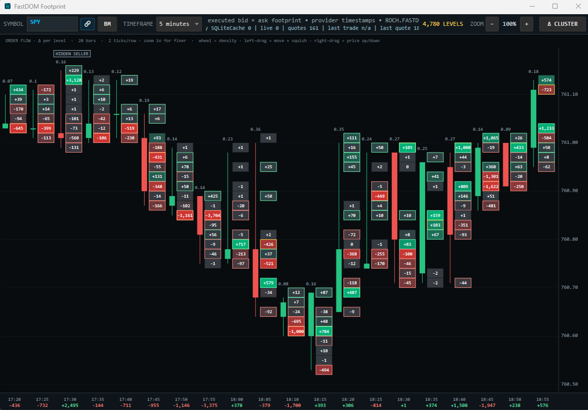
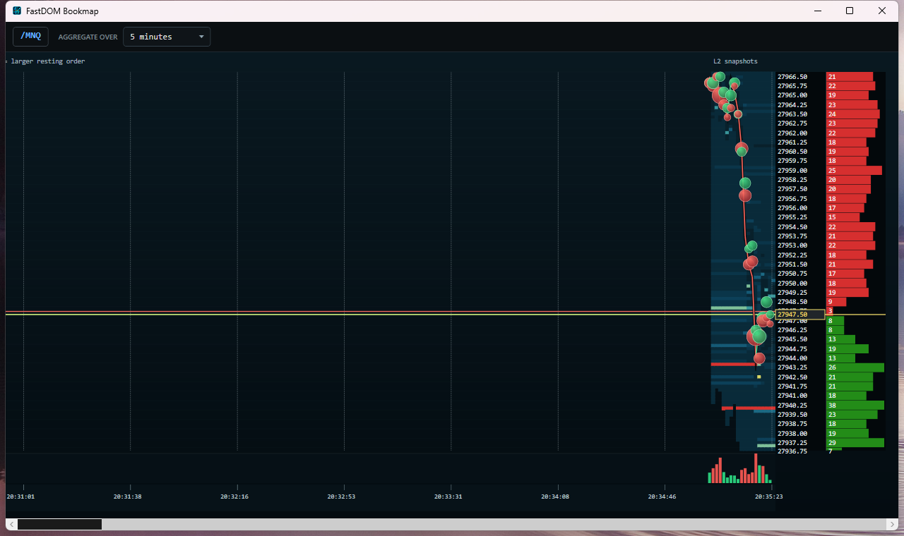

# FastDOM

**Discuss the idea. Size the trade. Execute. Manage the position.**

FastDOM is a free Windows trading terminal for **Schwab, NinjaTrader, and Alpaca**, combining AI trade discussions, active AI position management, fast order-entry workflows, and configurable risk- and dollar-sized hot buttons in one desktop workspace.

Talk through a thesis with AI, choose your intended risk or trade amount, and act from the chart, DOM, or a configured keyboard shortcut. When you explicitly enable **Manage** for an existing position, AI can propose supported protection changes through FastDOM's validation and execution controls.

**[Download the free Beta](https://fastdom.decoglobal.us/download)** · **[Explore the website](https://fastdom.decoglobal.us)** · **[Watch the training videos](https://fastdom.decoglobal.us/training)** · **[Getting started](docs/getting-started.md)** · **[Known limitations](docs/known-limitations.md)**

Published by **DECO GLOBAL SERVICES, INC.**

> FastDOM is proprietary software, currently available as a free Beta. This public repository contains documentation, screenshots, release information, and issue tracking. The application source code is not published here.

## What you can do

| Capability | Your workflow |
| --- | --- |
| **Discuss trade ideas with AI** | Use Trading Partner to question a long/short thesis, consider invalidation, compare alternatives, and discuss managing an existing position. Use Market Desk for broader research and watch planning. |
| **Active AI trade management** | Explicitly enable Manage on an open position to review current evidence and propose supported protection adjustments. Accepted actions pass through order validation, risk checks, and broker verification. |
| **Fast execution workflow** | Enter and manage orders from the chart or DOM, with configurable hot buttons and keyboard shortcuts for frequent actions. Keep order entry, cancellation, scale-outs, and protection controls close at hand. |
| **Trade by dollar risk** | Set a risk budget and stop reference; Risk Buy/Sell calculates quantity from the entry-to-stop distance and relevant instrument value. |
| **Trade a specific amount** | Configure dollar-amount hot buttons to calculate an order size from your intended trade value, or use fixed quantities and size presets. |
| **Automatic session handling** | Risk/Secure equity workflows adapt supported regular/extended-hours handling; virtual stops provide app-managed OCO-style protection when needed. |
| **Protection that follows position changes** | With reconciliation enabled, existing stops and targets resize from broker-confirmed additions and reductions. |
| **Order-flow context** | Explore footprint and liquidity heatmap views when your feed supplies compatible depth and execution data. |
| **A workspace that fits you** | Configure buttons, shortcuts, indicators, and layouts; review orders and positions alongside the chart. |

**Dollar risk and trade amount are different:** a $100 risk budget describes intended loss to the stop; a $5,000 trade amount describes intended position value. Actual fills, rounding, instrument multipliers, fees, gaps, and slippage affect the result. Neither is a guaranteed maximum loss or exact fill value.

AI discussions in Partner and Desk are advisory. **Manage is execution-capable**, requires an existing position and explicit activation, and disengages when flat. Execution speed depends on the broker, network, and market; no latency or fill-quality guarantee is claimed.

[Explore AI, sizing, and execution workflows →](docs/ai-and-execution.md)

## Build out the rest of your desk

- **Watch:** compare up to 24 symbols in a tiled chart wall.
- **Market Pulse:** align volatility, resting-book imbalance, and executed-trade delta across time.
- **Trade Copier:** deliberately enable supported action replication to follower accounts, with per-account sizing multipliers and execution status. Followers can receive real orders and can fill differently.
- **Options Hedging Map:** inspect estimated option-chain positioning and related chart levels, with coverage and model assumptions visible.
- **Margin monitor:** explore maintenance headroom and adverse-move sizing scenarios as planning estimates.
- **Performance and Learn:** review execution-based results, then discuss available trade evidence with AI.

## Coming from thinkorswim or DAS?

FastDOM brings familiar chart, ladder, and hotkey workflows together with its AI conversation, risk/amount sizing, and explicitly enabled position management. The pitch is the complete workflow in a free Beta workspace.

thinkorswim and DAS also offer capable order-entry tools. Read the [sourced workflow comparison](docs/platform-comparison.md) to see the distinctions without untested speed claims.

## See the tools

### Footprint

### Liquidity heatmap

Screenshots illustrate the interface and historical market data. They are not performance claims; appearance and available features can vary by build and feed.

## Connections and requirements

| Connection | What you supply |
| --- | --- |
| Simulation | No broker account needed to explore the simulated workflow |
| Schwab | Your approved trading and market-data developer applications and browser authorization |
| NinjaTrader | NinjaTrader 8, the supplied FastDOM bridge, an active account/feed, and appropriate data entitlements |
| Alpaca | Your own account API credentials and the appropriate paper/live configuration; [setup guide](docs/alpaca.md) |

The installer is for **Windows x64** and includes the .NET runtime. Default SQLite storage does not require Python, Java, or a Derby server. Market-depth and executed-flow tools depend on the upstream data available to your account. Broker/data charges may apply; no broker endorsement is implied.

Chart AI features require your own installed, signed-in Codex CLI. Hosted Ask FastDOM support chat does not require local Codex. Offline Help requires neither AI access nor an internet connection.

## Install and explore

1. Download the installer from the [official download page](https://fastdom.decoglobal.us/download).
2. Compare its SHA-256 with the checksum on that page.
3. Install, then launch **FastDOM Beta** from the Start menu.
4. Start in **Simulation**. Fresh installs have live trading disabled.
5. Open **More > Help** before configuring your own broker connection.

This early Beta is **unsigned**. Windows may display an unknown-publisher warning or prevent installation under your security policy. Clean-machine onboarding remains under verification. Review the [known limitations](docs/known-limitations.md) before using it.

## Current release

**Beta 20261026-004726-eea7c609** — October 26, 2026.

The current public installer includes the earlier customer-installation and packaging fixes, a chart crash repair, and options-view improvements. The [official download page](https://fastdom.decoglobal.us/download) provides the current installer and checksum. Additional display improvements shown in newer training lessons are prepared for a later installer; check each lesson's build note. See the [changelog](CHANGELOG.md).

Existing saved settings are preserved by updates. Review your NinjaTrader account and exact contract mappings before connecting; installing an update does not reset your preferences.

## Feedback and support

Use **Issues** for reproducible bugs and feature requests, and **Discussions**, when enabled, for setup questions and general feedback. Include your Beta build ID, Windows version, steps to reproduce, and the visible error.

**Never post account numbers, balances, positions, credentials, tokens, databases, activation files, or unredacted screenshots.** For private support, contact [support@decoglobal.us](mailto:support@decoglobal.us). See [SUPPORT.md](SUPPORT.md).

If FastDOM is useful to you, star this repository and share the official download page with other traders.

Copyright 2026 DECO GLOBAL SERVICES, INC. All rights reserved. Free Beta availability does not make FastDOM open source or grant rights to its application source code. Beta access may be restricted or discontinued. FastDOM does not promise trading returns.
