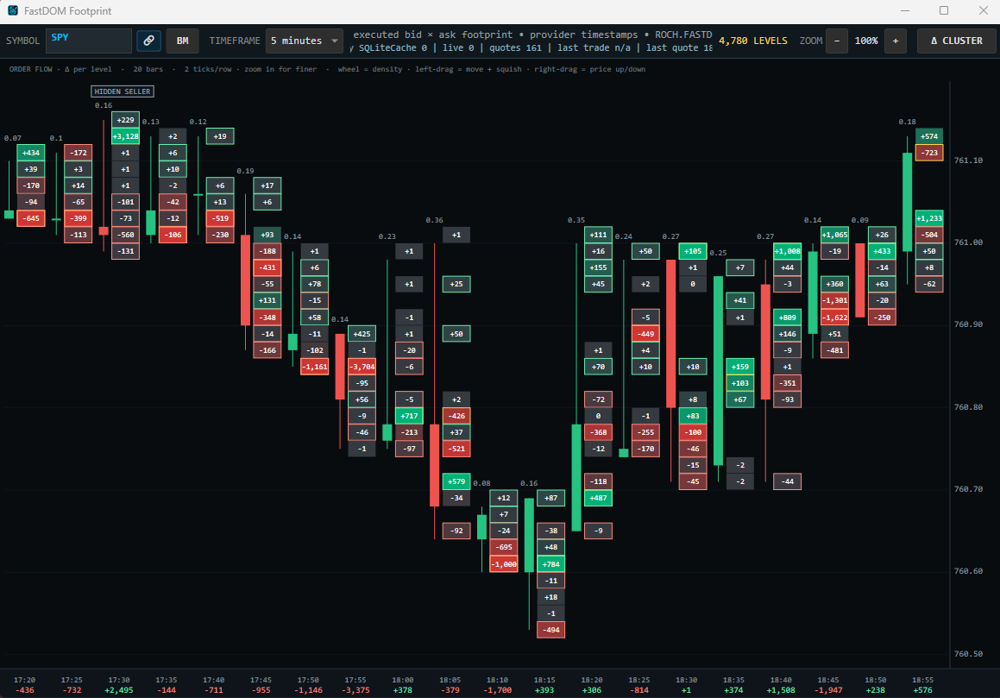
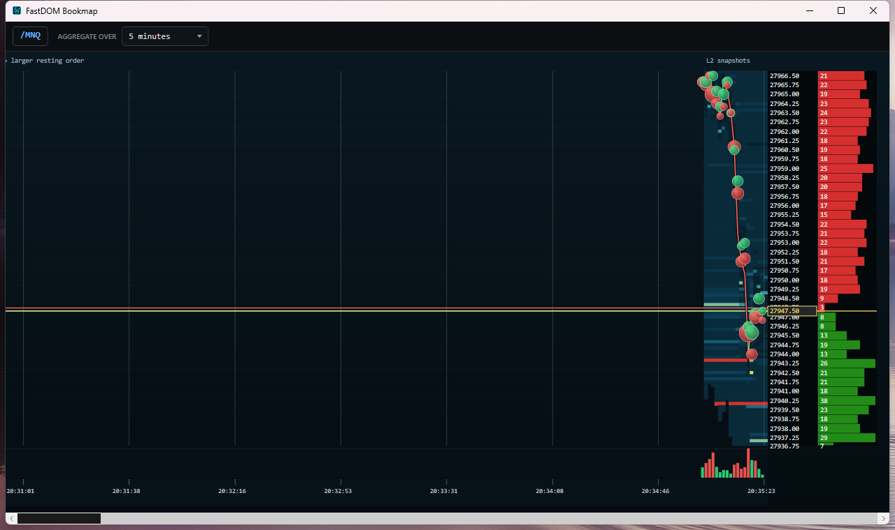

# FastDOM

FastDOM is a free Windows trading application I’m building for **Schwab, NinjaTrader, and Alpaca**. It combines chart and Depth of Market (DOM) order entry, risk-based sizing, and optional Codex or Claude tools. It’s currently in beta, and I’m looking for feedback on usability and reliability.

The AI tools can help review a trade idea or available market data. **Manage** is different: when explicitly enabled for an existing position, it can propose protection changes through the app’s validation and execution controls.

[Beta download](https://fastdom.decoglobal.us/download) · [Getting started](docs/getting-started.md) · [User manual](docs/manual.md) · [Known limitations](docs/known-limitations.md) · [Training videos](https://fastdom.decoglobal.us/training)

## Features

| Capability | Description |
| --- | --- |
| **Discuss trade ideas with AI** | Use Trading Partner to question a long/short thesis, consider invalidation, compare alternatives, and discuss managing an existing position. Use Market Desk for broader research and watch planning. |
| **Active AI trade management** | Explicitly enable Manage on an open position to review current evidence and propose supported protection adjustments. Accepted actions pass through order validation, risk checks, and broker verification. |
| **Chart and DOM order entry** | Enter and manage orders from the chart or DOM, with configurable hot buttons and keyboard shortcuts for frequent actions. |
| **Trade by dollar risk** | Set a risk budget and stop reference; Risk Buy/Sell calculates quantity from the entry-to-stop distance and relevant instrument value. |
| **Trade a specific amount** | Configure dollar-amount hot buttons to calculate an order size from your intended trade value, or use fixed quantities and size presets. |
| **Automatic session handling** | Risk/Secure equity workflows adapt supported regular/extended-hours handling; virtual stops provide app-managed OCO-style protection when needed. |
| **Protection that follows position changes** | With reconciliation enabled, existing stops and targets resize from broker-confirmed additions and reductions. |
| **Order-flow context** | Explore footprint and liquidity heatmap views when your feed supplies compatible depth and execution data. |
| **Workspace configuration** | Configure buttons, shortcuts, indicators, and layouts; review orders and positions alongside the chart. |

**Dollar risk and trade amount are different:** a $100 risk budget describes intended loss to the stop; a $5,000 trade amount describes intended position value. Actual fills, rounding, instrument multipliers, fees, gaps, and slippage affect the result. Neither is a guaranteed maximum loss or exact fill value.

AI discussions in Partner and Desk are advisory. **Manage is execution-capable**, requires an existing position and explicit activation, and disengages when flat. Execution speed depends on the broker, network, and market; no latency or fill-quality guarantee is claimed.

[AI, sizing, and execution documentation](docs/ai-and-execution.md)

## Other tools

- **Watch:** compare up to 24 symbols in a tiled chart wall.
- **Market Pulse:** align volatility, resting-book imbalance, and executed-trade delta across time.
- **Trade Copier:** deliberately enable supported action replication to follower accounts, with per-account sizing multipliers and execution status. Followers can receive real orders and can fill differently.
- **Options Hedging Map:** inspect estimated option-chain positioning and related chart levels, with coverage and model assumptions visible.
- **Margin monitor:** explore maintenance headroom and adverse-move sizing scenarios as planning estimates.
- **Performance and Learn:** review execution-based results, then discuss available trade evidence with AI.

## Workflow comparison

The [workflow comparison with thinkorswim and DAS](docs/platform-comparison.md) describes differences and links to sources. It does not claim measured speed or fill-quality advantages.

## Screenshots

### Footprint

### Liquidity heatmap

Screenshots illustrate the interface and historical market data. They are not performance claims; appearance and available features can vary by build and feed.

## Connections and requirements

| Connection | What you supply |
| --- | --- |
| Simulation | No broker account needed to explore the simulated workflow |
| Schwab | Your approved trading and market-data developer applications and browser authorization |
| NinjaTrader | NinjaTrader 8, the supplied FastDOM bridge, an active account/feed, and appropriate data entitlements |
| Alpaca | Your own account API credentials and the appropriate paper/live configuration; [setup guide](docs/alpaca.md) |

The installer is for **Windows x64** and includes the .NET runtime. Default SQLite storage does not require Python, Java, or a Derby server. Market-depth and executed-flow tools depend on the upstream data available to your account. Broker/data charges may apply; no broker endorsement is implied.

Chart AI features use your selected provider: your own installed, signed-in Codex CLI or Claude Code CLI. Hosted Ask FastDOM support chat does not require either local CLI. Offline Help requires neither AI access nor an internet connection.

## Installation

1. Download the installer from the [official download page](https://fastdom.decoglobal.us/download).
2. Compare its SHA-256 with the checksum on that page.
3. Install, then launch **FastDOM Beta** from the Start menu.
4. Start in **Simulation**. Fresh installs have live trading disabled.
5. Open **More > Help** before configuring your own broker connection.

This early Beta is **unsigned**. Windows may display an unknown-publisher warning or prevent installation under your security policy. Review the [known limitations](docs/known-limitations.md) before using it.

## Current release

**Beta 20261112-133159-dd226fee** — November 12, 2026.

Movers gains an ORB SCAN tab: a whole-market screen for opening-range candidates by gap, daily range and premarket dollar volume, with thresholds you can change and a line saying where the data comes from and how fresh it is. A stop on the chart can be converted to an AI trailing stop: the AI reviews price action about every 45 seconds, sets how tight to trail, and only ever moves the stop toward price. The main window can be zoomed from 70% to 130% with the two buttons beside More or Ctrl + and Ctrl −. Charts accept weekly timeframes. Configuration > General can reset selected parts of your setup to defaults, with a backup first. This build also fixes a moved stop leaving a second, dead marker at its old price, and Add Row in Chart Timeframes duplicating a row. Strategy Center is not included in this Beta.

See the [changelog](CHANGELOG.md), [official download](https://fastdom.decoglobal.us/download), [SourceForge mirror](https://sourceforge.net/projects/fastdom/files/beta/), and [disclaimer](https://fastdom.decoglobal.us/disclaimer).

## Feedback and support

Use **Issues** for reproducible bugs and feature requests, and **Discussions**, when enabled, for setup questions and general feedback. Include your Beta build ID, Windows version, steps to reproduce, and the visible error.

**Never post account numbers, balances, positions, credentials, tokens, databases, activation files, or unredacted screenshots.** For private support, contact [support@decoglobal.us](mailto:support@decoglobal.us). See [SUPPORT.md](SUPPORT.md).

## AI access

FastDOM’s Codex-powered trading tools can use your existing eligible ChatGPT plan through Codex CLI. Sign in with your own account—no separate OpenAI API key is required when using subscription access. This uses your included Codex allowance instead of separate usage-based API billing.

You control when to request analysis, which supported model to select, and whether to enable active position management. Trading tools remain available without AI. Requests consume your plan allowance; model access and usage limits apply. API-key authentication, if chosen, is billed separately. Hosted Ask FastDOM support chat is a separate service. Local CLI execution still sends AI requests to the provider.

See [official Codex authentication documentation](https://learn.chatgpt.com/docs/auth). Claude Code is also selectable in Configuration; it requires your own working, signed-in Claude Code CLI.

### Set up Codex or Claude Code

Choose **Configuration > General > AI PROVIDER**, install the selected CLI, and sign in under the same Windows user. Codex uses `codex login`; Claude Code uses `claude auth login`. Existing CLI sign-in is reused. Validate installation, then explicitly retry the AI action. FastDOM does not install the CLI or sign you in automatically.

[Download Codex desktop](https://chatgpt.com/download/) · [Codex CLI instructions](https://developers.openai.com/codex/cli/) · [Claude Code instructions](https://code.claude.com/docs/en/setup) · [Full provider guide](docs/ai-providers.md)

## Availability and licensing

FastDOM is free. There is currently no paid version or FastDOM subscription. This repository contains documentation and release information; the application source is not published under an open-source license. Beta access may be restricted or discontinued. FastDOM does not promise trading returns.

Copyright 2026 DECO GLOBAL SERVICES, INC. All rights reserved.
